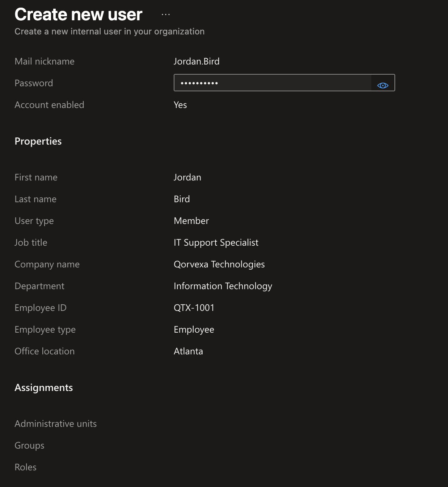
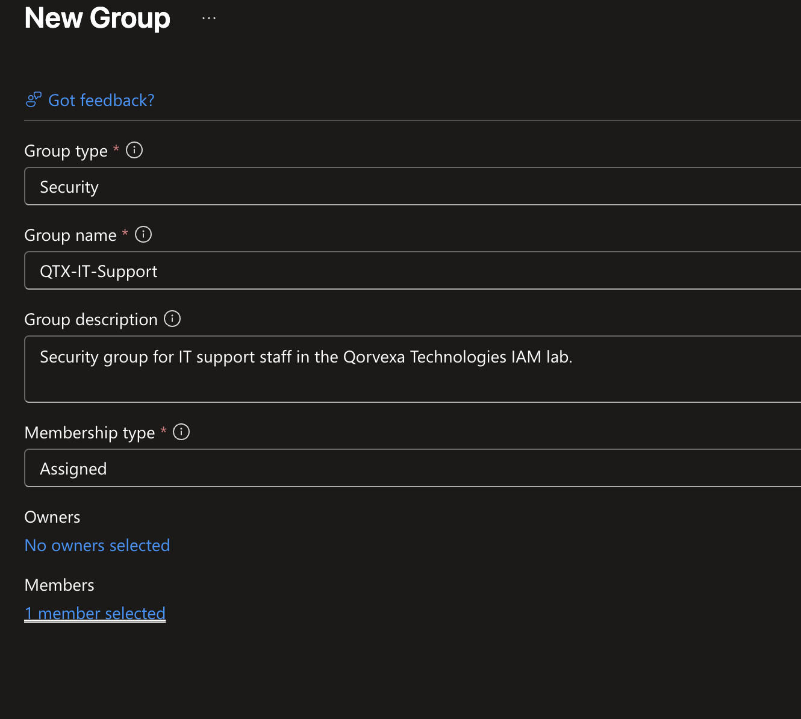
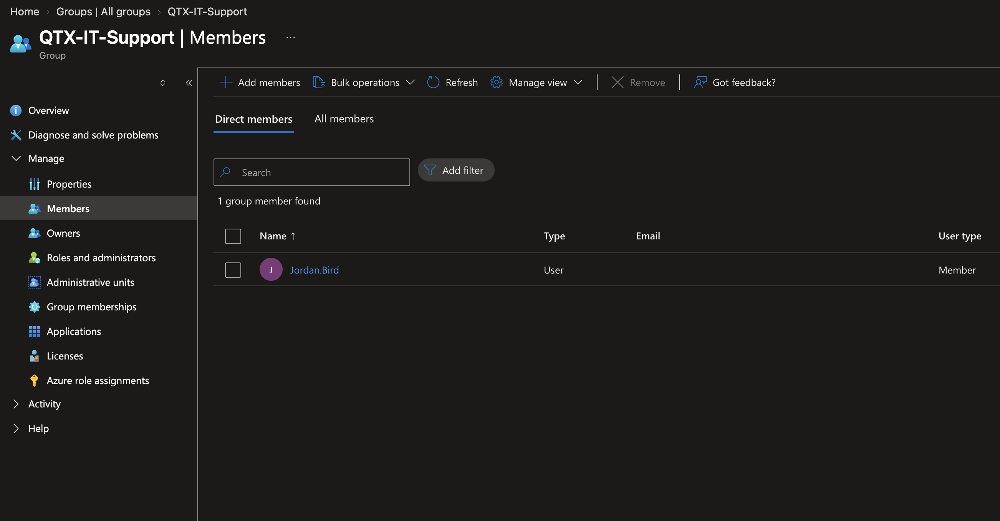
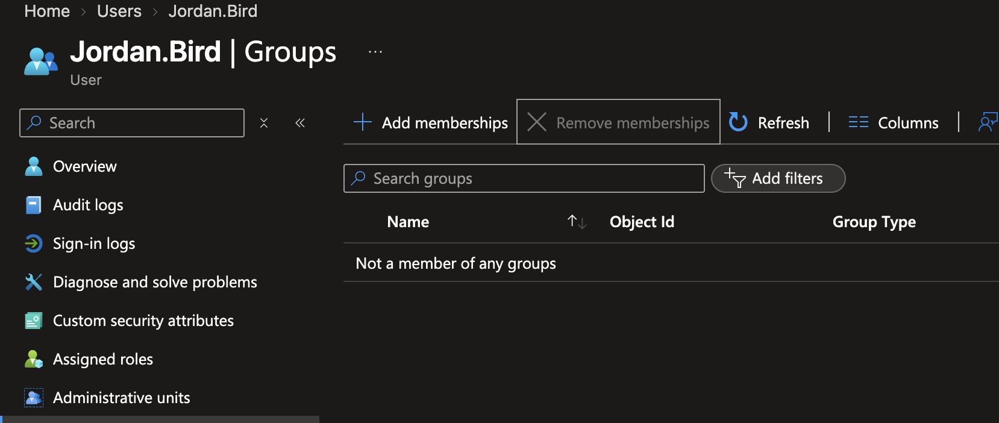
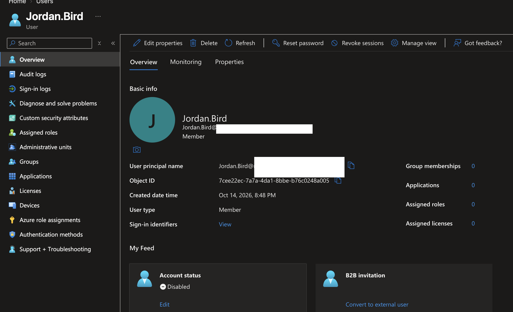

# IAM Lifecycle Management Lab

## Project Overview

This hands-on lab uses Microsoft Entra ID to simulate identity and access management (IAM) processes for a fictional organization, Qorvexa Technologies.

The project demonstrates employee onboarding, group-based access management, a job-role change, and employee offboarding.

## Objectives

- Provision a user account and configure employee attributes.
- Create a security group for IT support staff.
- Verify group membership.
- Simulate an employee job-role change.
- Remove group membership and disable the account during offboarding.

## Tools and Environment

- Microsoft Entra ID
- Microsoft Azure portal
- Qorvexa Technologies (fictional organization)

## Lab Walkthrough

### 1. Employee Onboarding

Created a sample employee account and configured its job title, department, employee ID, and office location.

### 2. Security Group Configuration

Created the `QTX-IT-Support` security group for the fictional organization's IT support staff.

### 3. Verify Group Membership

Confirmed that the sample employee was a member of the `QTX-IT-Support` security group.

### 4. Mover Event: Job-Role Change

Updated the sample employee's job title to simulate an internal role change.

.png>)

### 5. Leaver Event: Remove Group Access

Removed the sample employee's membership in the IT support security group as part of the offboarding simulation.

### 6. Disable the Account

Disabled the sample employee account to complete the simulated offboarding process.

## Security Concepts Demonstrated

- Identity lifecycle management (Joiner, Mover, Leaver)
- User provisioning and employee attribute management
- Group-based access management
- Access removal during offboarding
- Account disablement
- Least-privilege principles

## Scope and Limitations

This was a manually performed lab using a sample account in Microsoft Entra ID. It demonstrates individual IAM lifecycle tasks; it does not implement automated provisioning, automated workflows, or production access policies.

## Outcome

Completed a practical simulation of employee onboarding, a job-role change, and offboarding using Microsoft Entra ID.
